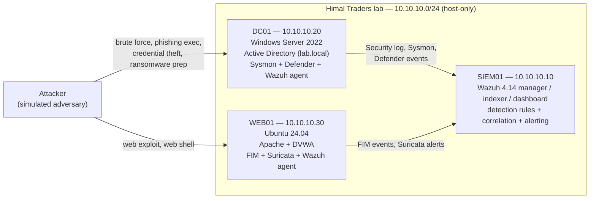
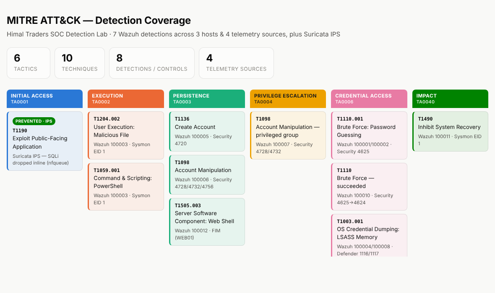

# SOC Detection & Response Lab


A home-built **Security Operations Center** lab that detects a realistic, end-to-end intrusion —
from first password-guess to ransomware — and treats every detection as tested, version-controlled
code. Built on a single 8 GB laptop, deployed across three hosts, and validated automatically on
every commit.

This repo is the **detection content and engineering practice** behind that lab: Sigma rule sources,
their Wazuh deployments, analyst runbooks, a threat model, and a CI pipeline that proves the
detections are valid before they ship.

---

## Why this project exists

Most "SIEM home lab" projects stop at *"I installed Wazuh and saw an alert."* This one goes further
and answers the questions a hiring manager actually cares about:

- **Did you detect the things that matter?** Detections are chosen from a written **threat model**,
  not at random, and mapped to **MITRE ATT&CK**.
- **Do your detections actually work?** Every rule was built with a repeatable lifecycle
  (hypothesis → telemetry → logic → **attack simulation** → tune → deploy) and verified by
  *running the real attack* against the lab.
- **Can your work be trusted and maintained?** Detections live in Git as **Detection-as-Code**,
  with a **CI pipeline** that validates them on every push, plus a **triage runbook** for each one.

---

## Architecture

A host-only VMware network (`10.10.10.0/24`) with a central SIEM and two monitored assets, sized to
run on 8 GB of RAM.



| Host | IP | Role | Telemetry shipped to SIEM |
| --- | --- | --- | --- |
| **SIEM01** | 10.10.10.10 | Wazuh 4.14 manager + indexer + dashboard | — (collector/analyzer) |
| **DC01** | 10.10.10.20 | Windows Server 2022, Active Directory domain controller | Windows Security log, Sysmon, Microsoft Defender |
| **WEB01** | 10.10.10.30 | Ubuntu 24.04, Apache + DVWA (vulnerable web app) | File Integrity Monitoring, Suricata network IDS |

> **8 GB constraint:** the SIEM runs continuously (tuned to a 1 GB JVM heap); the two monitored
> hosts are rotated as needed. The whole lab was designed to be reproducible on modest hardware
> with no paid cloud.

---

## Threat model

Detections are driven by a written threat model for a fictional 25-person Kathmandu trading company,
**Himal Traders Pvt. Ltd.** (see [`threat-model.md`](threat-model.md)). It identifies the crown-jewel
asset (Active Directory on DC01), the likely threat actors, and three primary attack paths:

1. **Ransomware via RDP** — brute force an exposed login, escalate, steal credentials, destroy
   backups, encrypt. *(highest risk)*
2. **Web application compromise** — exploit the public web server, plant a web shell.
3. **Phishing** — a malicious document executes code, then steals credentials.

Each detection below maps back to a specific step on one of these paths.

---

## Detection coverage

Seven detections spanning the full attack lifecycle, across three hosts and four telemetry sources.
Each has a Sigma source of truth, a deployed Wazuh rule, and an analyst runbook.

| # | Rule ID(s) | Detection | MITRE ATT&CK | Tactic | Host | Telemetry |
| --- | --- | --- | --- | --- | --- | --- |
| 1 | `100001` / `100002` | Brute force (failed logons) | T1110.001 | Credential Access | DC01 | Windows Security (4625) |
| 2 | `100010` | **Successful** brute force (failures → success) | T1110 | Credential Access | DC01 | Windows Security (4625→4624) |
| 3 | `100003` | Office application spawning a shell | T1204.002 / T1059.001 | Execution | DC01 | Sysmon (EID 1) |
| 4 | `100004` / `100008` | LSASS credential theft (blocked by Defender) | T1003.001 | Credential Access | DC01 | Microsoft Defender (1116/1117) |
| 5 | `100005` / `100006` / `100007` | New account / added to privileged group | T1136 / T1098 | Persistence / Priv. Esc. | DC01 | Windows Security (4720/4728/4732/4756) |
| 6 | `100012` | Web shell dropped in web root | T1505.003 | Persistence | WEB01 | File Integrity Monitoring |
| 7 | `100011` | Shadow copy / backup deletion | T1490 | Impact | DC01 | Sysmon (EID 1) |

### Kill-chain view

```
Initial Access ──▶ Execution ──▶ Credential Access ──▶ Persistence / PrivEsc ──▶ Impact
  (brute force)    (macro→shell)   (LSASS dump,          (backdoor admin,          (shadow copy
   #1 #2            #3              web shell) #4 #6       privileged group) #5      deletion) #7
```

The point isn't just coverage — it's that an analyst can watch an intrusion **progress** through
these stages, with each stage raising its own alert and pointing to its own response runbook.

### ATT&CK coverage map



*10 techniques across 6 tactics, each mapped to the rule(s) that cover it. A machine-readable
[ATT&CK Navigator layer](metrics/attack-navigator-layer.json) is in `metrics/` — load it at
[mitre-attack.github.io/attack-navigator](https://mitre-attack.github.io/attack-navigator/).*

---

## Detection engineering practices

What makes this a *detection engineering* project rather than a pile of rules:

- **Detection-as-Code.** Every rule is authored in [Sigma](https://sigmahq.io) (vendor-neutral
  source of truth) and deployed as a Wazuh rule. Both live in Git and are reviewed as code.
- **Continuous Integration.** A [GitHub Actions pipeline](.github/workflows/detections-ci.yml) runs
  on every push: it validates the Sigma rules (real `sigma-cli`) and runs a custom
  [test harness](tests/validate_detections.py) that checks rule-ID uniqueness and range, required
  metadata, rule-dependency resolution, and that every runbook maps to a real rule. The badge at the
  top of this README reflects that pipeline live.
- **Tested against real attacks.** Each detection was verified by executing the actual technique in
  the lab (e.g. `vssadmin delete shadows`, a `LogonUser` brute force, a comsvcs LSASS dump,
  dropping a PHP web shell) and confirming the alert fired — then tuned to remove false positives.
- **Analyst-ready runbooks.** Every detection ships with a [runbook](runbooks/): what fired and why
  it matters, triage questions, how to tell a false positive, containment steps, and escalation
  criteria — plus the real tuning history and lessons from building it.
- **Defense in depth & honest telemetry.** Where one data source failed (Sysmon's LSASS
  ProcessAccess hook didn't fire on a hardened host), the detection was rebuilt on the telemetry that
  *was* reliably available (Defender's block event) — because you detect with the telemetry you
  have, not the telemetry you wish you had.

---

## Repository structure

```
soc-detection-lab/
├── .github/workflows/
│   └── detections-ci.yml          # CI: validates every detection on each push
├── detections/
│   ├── sigma/                     # Sigma rule sources (vendor-neutral source of truth)
│   └── wazuh/
│       └── local_rules.xml        # Deployed Wazuh detection rules (IDs 100001–100012)
├── runbooks/                      # One triage runbook per detection
├── tests/
│   └── validate_detections.py     # Detection-as-Code validation harness
├── response/                      # SOAR: auto-disable account on successful brute force
├── ips/                           # Suricata inline IPS (NFQUEUE) + hardened drop rules
├── hunting/                       # Threat-hunting sweep (Chainsaw + this repo's Sigma)
├── metrics/                       # ATT&CK coverage map + Navigator layer
├── threat-model.md                # Himal Traders threat model (drives what we detect)
└── README.md
```

---

## Tech stack

**SIEM / detection:** Wazuh 4.14 (manager, indexer, dashboard) · Sigma · Sysmon · Suricata
**Endpoints:** Windows Server 2022 / Active Directory · Ubuntu 24.04 · Microsoft Defender · DVWA
**Engineering:** Git / GitHub · GitHub Actions (CI) · Python (test harness) · PowerShell
**Framework:** MITRE ATT&CK

---

## Roadmap

- [x] Lab build, threat model, and 7 detections across 3 hosts / 4 telemetry sources
- [x] Analyst runbooks for every detection
- [x] Detection-as-Code: Sigma sources + CI validation pipeline
- [x] MITRE ATT&CK coverage map + Navigator layer (`metrics/`)
- [x] Intrusion **prevention** — Suricata inline IPS drops SQLi before it lands (`ips/`)
- [x] Automated response (SOAR) — auto-disable on successful brute force (`response/`; script + detection verified, auto-trigger documented)
- [x] Threat hunting — Chainsaw sweep of exported logs with this repo's own Sigma rules (`hunting/`)

---

## About

Built by **Prashanna Ghimire** as a hands-on study of defensive security and detection engineering.
Every component was built, broken, debugged, and tested by hand — the
[runbooks](runbooks/) capture the real engineering decisions and the problems solved along the way.
